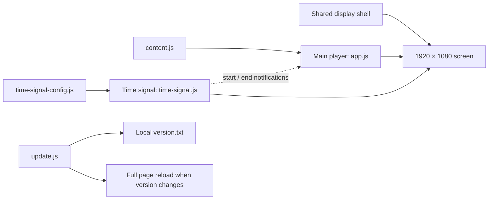

# CSSU Kiosk — Project Guide

**Documentation baseline:** 24 October 2026  
**Product:** an unattended digital community board for the University of Toronto Computer Science Student Union  
**Display target:** Orange Pi 3B, RK3566, 4 GB RAM, HDMI, 1920 × 1080, Chromium under Cage

The application displays one full-screen event poster, an integrated Toronto clock, a small announcement, and a scrolling shop-price ribbon. At each Toronto ten-minute boundary, a separate 20-second world-time broadcast temporarily takes over the screen.

This is a static display application. Normal operation requires no mouse, keyboard, touch input, account, shopping cart, or checkout. All essential content and assets are local. The screen can continue displaying without internet access.

## Documentation map

| Document | Audience and purpose |
| --- | --- |
| [DESIGN-SPEC.md](DESIGN-SPEC.md) | Human designers and developers: approved appearance, composition, motion, and content rules |
| [AGENTS.md](AGENTS.md) | AI coding assistants: project instructions, protected decisions, and change workflow |
| [docs/DEPLOYMENT-CONTRACT.md](docs/DEPLOYMENT-CONTRACT.md) | Engineering/deployment requirements and release acceptance: poster appearance, ten-minute/20-second clock, event expiry/standby, package integrity, local evidence, and pending device checks |
| [ASSET-SOURCES.md](ASSET-SOURCES.md) | Provenance of official CSSU brand assets |
| [README-zh.md](README-zh.md) | Earlier Chinese prototype guide; use this English guide for the current production handoff |

These documents describe the current frontend and the owner's deployment contract. They do not certify that the prototype has been installed or endurance-tested on the target hardware.

## 1. Run the display

### Desktop preview

Open `index.html` in Chrome or Safari. Keep the directory intact. No package installation or build is required. A non-16:9 window shows the complete canvas with surrounding space; a 1080p full-screen viewport fills the display.

For an HTTP preview, run this command from the project directory:

```sh
python3 -m http.server 8080 --bind 127.0.0.1
```

Open `http://127.0.0.1:8080/`. Stop the temporary server with Control+C. Python is needed only for this optional preview method.

To demonstrate the time signal immediately, open `time-signal-preview.html`, or append `?time-signal-preview=1` to the index URL. It plays once, returns to the poster, and leaves normal scheduling enabled. Use plain `index.html` for normal unattended operation; the preview parameter intentionally replays after a reload.

### Production target

The owner-supplied deployment contract specifies:

| Item | Production target |
| --- | --- |
| Operating system | Armbian / Debian 13 |
| Local origin | `http://127.0.0.1:8080/`, served by Nginx |
| Active directory | `/srv/cssu-kiosk/current/` |
| Browser / compositor | Chromium Wayland kiosk / Cage |
| Distribution | GitHub Releases for `chrislxn/cssu-kiosk` |
| Release asset | `kiosk.zip`, with `index.html` at the archive root |
| Deployment checks | Device-side updater, every 30 minutes |
| Browser version checks | Frontend `update.js`, every 10 seconds |

The device updater owns downloads, checksum verification, release directories, the active symlink, and generation of `version.txt`. System services own process recovery and reboots. The frontend does not implement these functions.

`start-kiosk.sh` is a retained prototype helper that opens a local `file://` page. It does not implement the Nginx production deployment. Production uses the local HTTP origin and the existing device-managed browser command.

## 2. Project structure

```text
index.html                    Shared screen and local script/style inclusion
display-shell.js              Canvas fitting, independent of content modules
content.js                    Event, shop, announcement, and main-player settings
app.js                        Event player and shop/announcement rendering
styles.css                    Main display styles and shared base styling
time-signal-config.js         Independent world-clock configuration
time-signal.js                Independent scheduling and broadcast controller
time-signal.css               Broadcast-specific styles
time-signal-preview.html      Operator-only, one-shot preview entry
update.js                     Local version polling and full-page reload
sw.js                         Optional offline shell cache; disabled by default
assets/                       Local brand files, illustrations, and product SVGs
README.md / DESIGN-SPEC.md     Human documentation
AGENTS.md                     Instructions for AI contributors
docs/DEPLOYMENT-CONTRACT.md    Owner-supplied engineering requirements
version.txt                   Local demo fixture; exclude from production ZIP
start-kiosk.sh                Legacy local-file prototype launcher
```

The current script order in `index.html` is `display-shell.js`, `time-signal-config.js`, `content.js`, `app.js`, `time-signal.js`, then `update.js`. Each is a separate deferred local script. Keep the shell, configuration, content, and controller responsibilities distinct.

## 3. Module boundaries



The time-signal controller does not read `CSSU_CONTENT` or call `CSSUSignage`. It has its own configuration, scheduling, timers, and session-storage key. The main player does not call the time-signal controller.

The only playback coordination is through document events:

| Event | Producer | Main-player response |
| --- | --- | --- |
| `cssu:time-signal-start` | Time-signal controller; `detail.durationMs` contains the duration | Suspend automatic event and announcement advancement |
| `cssu:time-signal-end` | Time-signal controller | Resume the current event with a fresh full slide interval |

The controller adds `time-signal-active` to `#screen` while broadcasting. CSS pauses the price ribbon and slide-progress animation. It temporarily hides the underlay from the accessibility tree, then restores its prior attributes.

Event edits and rejected event updates do not reset the time signal. The time signal can run without the event-player API, and the event player can run without the time-signal controller. This is module separation, not process isolation: both share a browser thread, `index.html`, the screen container, base styling, and logo resources. Changes to shared structure or global styles need checks in both modes.

## 4. Edit content

Edit `window.CSSU_CONTENT` in `content.js`, then reload or deploy a new release. These are ordinary JavaScript objects, loaded as local scripts so desktop file previews do not require JSON fetching.

| Field | Meaning / current default |
| --- | --- |
| `settings.timezone` | Main clock and event schedules; `America/Toronto` |
| `settings.slideSeconds` | Main event interval; 14 seconds; validated range 5–300 |
| `settings.announcementSeconds` | Announcement interval; 10 seconds; range 5–300 |
| `settings.tickerPixelsPerSecond` | Price-ribbon speed; 70; range 20–160 |
| `settings.serviceWorker` | `false`; preserve unless explicitly required and tested |
| `settings.persistContent` | `false`; bundled content takes precedence on reload |
| `coffee` | The first price-ribbon item |
| `menu` | Remaining shop items; 1–12 entries |
| `slides` | Event posters; 1–3 entries in this version |
| `announcements` | Notices; 0–20 entries |

Use short, two-line titles and one-sentence descriptions. [DESIGN-SPEC.md](DESIGN-SPEC.md) distinguishes recommended copy lengths from validation limits. Retained fields such as `detail`, `coffee.note`, `shopNote`, `shortTitle`, and `shortDetail` are still validated even where they are not visible. Do not remove or rename them without updating their schema and rendering deliberately.

`slides[].isSample` is an optional boolean. Omitted or `true` keeps the visible `SAMPLE EVENT` label and accessible sample-event suffix for existing demo data. Set it to `false` only for owner-approved real events. The generic standby poster is not an event and carries no sample label.

### Current event content and provenance

The two owner-supplied Instagram screenshots replace the three fictional demo posters. Each uses the shared poster composition with a reference-inspired event palette and an original local SVG illustration; the illustrations are decorative, not the original event artwork. `fumbles` pairs pale blue, navy, cloud white, and a peach repair motif with `microphone.svg`. `bytes` pairs sky blue and yellow-green with `world-food.svg` (world plate, food, and flight route). The original `code`, `play`, and `build` themes remain available. Theme and art values use separate internal allowlists in `app.js`.

The current poster theme is reflected in `#screen[data-poster-theme]` so the shared masthead and notices stay legible on a light poster. These palette rules target only the poster's masthead/notice/progress, not the independent time-signal overlay; standby restores the original dark palette. No event-specific motion, remote resources, or font dependencies are introduced. The optional worker remains disabled; its shell manifest would need the event SVGs added and migration verification before any future opt-in.

| Event | Toronto date/time | Venue | Poster details |
| --- | --- | --- | --- |
| Fumbles & Failures | November 3, 2026, 1–4 PM | BA3200 | CSSU × WiCS; profs, grad students, undergrads; RSVP link in @uoftcssu bio |
| Bytes Around the World | November 6, 2026, 3–5 PM | BA3200 | Free food |

Source: owner-provided screenshots of @uoftcssu (Fumbles & Failures is co-posted with @uoftwics), supplied for the October 31, 2026 maintenance request. The posters omit a year; 2026 follows that request context. No RSVP destination was provided, so the board refers to the account bio without inventing a URL.

Both posters and their corresponding notices are eligible immediately (`startsAt: null`, `schedule: null`) to promote the upcoming events. They expire at the advertised end time, exclusively: `2026-11-03T16:00:00-05:00` and `2026-11-06T17:00:00-05:00`. Toronto is on EST after the November 1 DST change. After both expire, the existing eligibility mechanism selects the neutral community standby poster; expired event notices also disappear. The demo-price disclaimer remains in place.

Product `icon` values select local files from `assets/products/`: `cola`, `energy`, `bolt`, `chips`, `chocolate`, `icecream`, `gum`, and `mini-chocolate`. Coffee uses its own `coffee` SVG. Unknown values use the local `snack` fallback. Every visible item must retain a suitable picture.

### Current owner-provided price baseline

All prices are CAD strings, not calculated checkout totals.

| Item | Price |
| --- | ---: |
| Coffee to go | $1.25 |
| Soda cans | $1.00 |
| Monster | $2.75 |
| Red Bull | $2.75 |
| Chips | $0.75 |
| KitKat · large | $1.50 |
| Ice cream sandwich | $0.50 |
| Gum | $2.00 |
| Mini chocolate | $0.50 |

Treat `content.js` as the current source of truth. These values were supplied by the owner, not independently verified against a live inventory system. Keep the existing demo-price notice until the owner requests a production-content change. Juice boxes have no agreed price and are omitted.

### Validity and recurring windows

Events and announcements accept `startsAt`, `endsAt`, and `schedule`. `null` means unrestricted. Absolute timestamps require `Z` or an explicit UTC offset. Start is inclusive; end is exclusive.

```js
startsAt: "2026-11-02T09:00:00-05:00",
endsAt: "2026-12-01T00:00:00-05:00",
schedule: { weekdays: [1, 2, 3, 4, 5], from: "09:00", to: "18:00" }
```

Weekdays use Sunday = 0 through Saturday = 6. Recurring windows use `settings.timezone`. An overnight Friday `22:00`–`02:00` window continues into Saturday; the weekday identifies the starting day. Equal start/end times are invalid; use `null` for an unrestricted window. Eligibility is checked once per second. When nothing is eligible, the player uses a standby poster and a default notice.

### Optional developer interface

`CSSUSignage.getContent()` returns a copy. `updateContent(data, { persist: false })` validates before applying; invalid updates leave the existing content in place. `getState()`, `isEligible(item, date)`, `clearCache()`, `reset()`, and `destroy()` support maintenance and verification. They are not on-screen controls.

Persisting content requires both `settings.persistContent: true` and an explicit `{ persist: true }` update. This opt-in store can override bundled content on the next load. Keep it off for the ordinary release-driven workflow.

## 5. World-time broadcast

Edit only `window.CSSU_TIME_SIGNAL_CONFIG` in `time-signal-config.js` for clock configuration. The approved total duration is **20 seconds**.

| Time in the sequence | Screen |
| --- | --- |
| 0–5 s | Toronto alone; includes the opening sweep |
| 5–12.2 s | Four portrait columns: Los Angeles, New York, Shanghai, London |
| 12.2–19.4 s | Four portrait columns: Tokyo, Seoul, New Delhi, Sydney |
| 19.4–20 s | Exit transition, then restore the poster |

The anchor is always Toronto's `:00`, `:10`, `:20`, `:30`, `:40`, and `:50`, independently of the main player's schedule timezone. Browser IANA time-zone rules calculate all nine local dates, 24-hour times, seconds, abbreviations, and UTC offsets. This includes daylight-saving changes, New Delhi's half-hour offset, and different calendar days.

Keep the nine-city array in the approved order. Indices 0, 1–4, and 5–8 form the three pages. Missing or invalid optional city data falls back to the built-in cities. The controller accepts 7–30 seconds for maintenance flexibility; this does not change the approved default of 20 seconds.

The controller prebuilds the clock views, formatters, and local artwork, then reserves the next absolute Toronto ten-minute deadline with one `setTimeout`. At that deadline its callback starts the signal directly and reserves the next actual clock boundary. It does not poll for the correct second, wait two seconds, use a grace window, or schedule “10 minutes after the last callback.” There is no repeating scheduler interval. The one-second update exists only inside the active 20-second broadcast to display seconds.

A page opened or restored after a boundary waits for the next boundary; it does not start a late catch-up. An operator preview is preempted if an actual scheduled boundary arrives. Visibility and back/forward-cache restoration re-arm the future deadline. Only completed scheduled signals are persisted for same-slot deduplication; previews do not consume scheduled slots. Repeated daylight-saving hours have distinct absolute-time slot IDs.

Browser timers are event-loop deadlines, not hard real-time hardware interrupts. A blocked/frozen browser cannot paint a frame on time. A registered foreground callback that arrives late still executes its task once; there is no seconds-window condition that silently discards it. `CSSUTimeSignal.getState()` exposes `nextScheduledAt`, `lastScheduledAt`, `dispatchDelayMs`, and `lastOutcome` for diagnosis, with no on-screen diagnostics. The device must maintain a correct system clock and responsive browser; OS clock corrections during an otherwise continuously foreground page cannot be observed immediately without polling. Timing simulation and a short browser deadline test do not establish target-device endurance or a zero-latency guarantee.

The device's system time and browser time-zone data must be correct. The frontend does not synchronize the operating-system clock. `CSSUTimeSignal.preview()`, `getState()`, `boundaryAt(date)`, `isActive()`, and `destroy()` are developer interfaces, not viewer interactions.

## 6. Version checks and offline operation

`index.html` must retain `<script src="update.js" defer></script>`. Over HTTP(S), this script requests same-directory `./version.txt` every 10 seconds with `cache: 'no-store'` and an 8-second timeout. Requests do not overlap. The first successful non-empty response establishes a baseline; a later changed value triggers a full `location.reload()`.

Empty responses, HTTP failures, and request errors keep the current screen running. The checker never contacts GitHub. Direct `file://` previews skip the checker. In production, Nginx remains local and available when the internet is down, so installed content continues to work.

`sw.js` is disabled by default. If enabled for an explicitly approved use case, its shell cache must include every required local asset, bypass `version.txt` and `no-store` requests, and be updated and tested for each release. The version checker removes only `cssu-signage-shell-*` caches before reloading when it detects a new version. Do not assume this makes arbitrary previous service-worker migrations safe without a test.

The current version checker accepts any successful non-empty text as a version; it does not validate release-tag syntax. The local endpoint must return plain version text. Stronger response validation is a separate future change, not a feature claimed by this documentation.

## 7. Packaging and deployment boundary

**Local handoff archive:** the existing `cssu-signage-demo.zip` contains a `cssu-signage/` directory, documentation, prototype helpers, and a local `version.txt` fixture. It is a convenient desktop-preview bundle, not a production release asset.

**Production archive:** create a separately prepared asset named `kiosk.zip` according to [the deployment contract](docs/DEPLOYMENT-CONTRACT.md). It must have `index.html` at its root, contain every referenced runtime script/style/asset, require no device-side build, and **exclude `version.txt`**. The device updater generates that file from the activated GitHub Release tag. Do not manually maintain or increment the demo fixture as the production versioning mechanism.

Do not upload the folder-wrapped demo archive unchanged. Publishing a GitHub Release, changing Nginx/systemd/Cage, restarting services, and changing the active symlink are separate operational actions; this frontend documentation does not perform or authorize them.

## 8. Verification and handoff

For a content-only edit, check syntax, the edited values, eligibility, and representative rendered copy. For shared layout or clock-controller changes, verify both the normal display and the complete broadcast at 1920 × 1080.

Use [Release Acceptance Tests](docs/DEPLOYMENT-CONTRACT.md#11-release-acceptance-tests) for the current per-release checklist and evidence/sign-off requirements. [DESIGN-SPEC.md](DESIGN-SPEC.md) version 1.1 defines the approved November palettes, expiry behavior, ten-minute schedule, and 20-second three-page sequence. Keep device release checks, browser version checks, poster rotation, and world-time scheduling distinct when reviewing changes.

Useful syntax checks from the project directory:

```sh
node --check content.js
node --check app.js
node --check time-signal-config.js
node --check time-signal.js
node --check update.js
```

Node is a development check, not a runtime dependency. Syntax checks do not verify behavior. Check these behaviors when the relevant module changes:

Run the restored clock and module-boundary regressions from `frontend/` with `node --test tests/*.test.mjs`. They cover exact ten-minute deadlines, late callbacks without drift, completed-slot deduplication, preview preemption, page restoration, a 144-signal day, 20-second playback, timezone/date boundaries, and event/clock independence.

- All nine product pictures load locally; duplicated ticker groups have identical width and loop without a gap.
- Posters and notices rotate automatically, with no buttons, hover pauses, input handlers, or blocking dialogs.
- One-shot Toronto ten-minute deadlines with no idle polling, the 1+4+4 city order, 20-second return, midnight/date changes, India offset, daylight-saving boundaries, and completed-slot deduplication remain correct.
- Activity edits and rejected data updates do not reset an active broadcast; each player runs without the other's API.
- The lifecycle notifications pause the event player and resume the same event with a fresh interval.
- Unchanged, changed, empty, failed, and timed-out version responses behave correctly; refreshed assets are new under the actual Nginx headers.
- All release references resolve, the ZIP opens correctly, its root is correct, and production version metadata is device-generated.

The prototype has had browser checks of its 1080p layouts, assets, grouped clock display, and return to the poster. Development simulations covered timing, time zones, schedule boundaries, module separation, and version checking. The clock implementation and regression tests were restored from the owner-supplied previous `cssu-signage.zip` version (ten-minute scheduling, 20-second broadcast), retaining the current November event posters. Those observations do not replace a target-device acceptance run. ARM frame rate, GPU/driver behavior, production Nginx/service-worker migration, reboot recovery, and long-duration unattended stability must be verified on the Orange Pi before calling a release production-ready.
